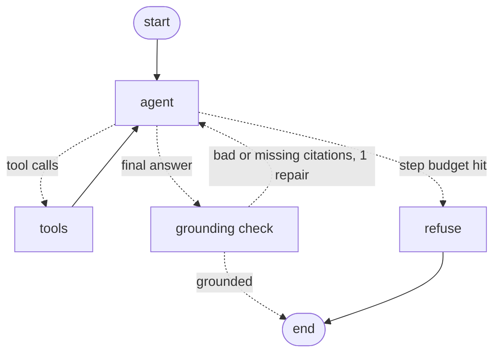

# LangGraph ReAct Agent with RAG

A ReAct agent that answers questions over a documentation corpus using FAISS retrieval and a calculator tool — built as an explicit LangGraph state machine, with a test suite that asserts **which tools get called** and **whether the answer is grounded in what was retrieved**.

```console
$ python -m agent ask "How many times are failed webhook deliveries retried?"
Lumen Pay sends each event to your endpoint as an HTTPS POST. Your endpoint must respond with a 2xx status within 10 seconds. Failed deliveries are retried up to 8 times over 72 hours with exponential backoff. [webhooks#1]

tools: ['search_knowledge_base']  grounded: True  steps: 2
```

*(Output from the bundled offline policy, which quotes the retrieved passage. A real model writes a shorter answer in its own words — same graph, same checks.)*

## The graph



It is written by hand instead of using `create_react_agent` because the two things that separate a demo agent from one you can ship are not in the prebuilt loop:

- **Step budget.** A model that keeps calling tools is stopped after `max_steps` turns. The last tool request is refused, not executed, and the agent says it could not finish rather than answering from nothing.
- **Grounding check.** Search results carry passage ids (`[refunds#1]`). The final answer is checked against the ids actually retrieved during the run:
  - a citation that was never retrieved → rejected
  - retrieval was used but nothing is cited → rejected
  
  A rejected answer gets one repair turn listing the ids it may use. If it is still ungrounded, the answer is returned with `grounded=False` so the caller decides what to do — it is flagged, never silently passed off.

Tool failures (unknown tool name, wrong arguments, a tool raising) come back to the model as error messages it can recover from.

## Layout

| File | What it does |
|---|---|
| `agent/graph.py` | State, nodes, routing, `run()` |
| `agent/index.py` | Heading-aware chunking, FAISS `IndexFlatIP` (exact cosine), save/load with an embedder-mismatch guard |
| `agent/embeddings.py` | `HashingEmbedder` (offline, deterministic) and `OpenAIEmbedder` (any OpenAI-compatible endpoint) |
| `agent/tools.py` | `search_knowledge_base` (returns retrieved ids as a tool artifact) and `calculator` (AST-walking evaluator — model input never reaches `eval`) |
| `agent/evals.py` | Dataset-driven behavioural eval |
| `agent/models.py` | Chat model loading and the offline policy model |

## Quick start

```bash
pip install -e ".[dev]"
pytest                                             # 46 tests, no network

python -m agent ingest data/docs                   # build the FAISS index
python -m agent ask "How long is the refund window?" --trace
python -m agent eval evals/dataset.jsonl           # exit code 1 below --min-pass-rate
```

With no credentials the CLI uses `OfflinePolicyModel` — a fixed search-then-answer policy, **not an LLM** — so the graph, tools, retrieval and eval harness can run end to end in CI. To use a real model:

```bash
pip install -e ".[openai]"        # or ".[anthropic]"
cp .env.example .env              # set LLM_PROVIDER, LLM_MODEL and the API key
```

Set `EMBEDDING_MODEL` to switch from the hashing embedder to a real embedding model, then re-run `ingest` (the index refuses to load with a different embedder than it was built with).

## Tests

`tests/fakes.py` provides a `ScriptedChatModel` that replays a fixed sequence of model turns and records every prompt it was sent, so each test pins down one behaviour exactly:

| Area | What is asserted |
|---|---|
| Expected tool calls | Retrieval before answering · search → calculator ordering and arguments · parallel tool calls · no retrieval for pure arithmetic · system prompt and tools bound on every turn |
| Grounded answers | Fabricated citation is rejected and repaired · missing citation is sent back · persistently ungrounded answer is flagged · the model's next turn really contains the retrieved passage |
| Failure handling | Unknown tool name · wrong tool arguments · runaway loop stopped by the step budget |
| Retrieval | Chunk boundaries and ids · ranking on four queries · irrelevant queries return nothing · index round-trip |
| Calculator | Arithmetic cases, and rejection of `__import__`, attribute access, names, giant exponents |
| Eval harness | Bundled dataset passes with real retrieval · a right answer reached *without* retrieval fails · wrong tool order fails |

### Eval dataset

`evals/dataset.jsonl` scores each case on four independent axes, because an agent can produce the right string for the wrong reason:

```
case              tools  cite   answer  grounded  steps
sandbox-limit     pass   pass   pass    pass      2
limit-math        pass   pass   pass    pass      3
...
6/6 cases passed (100%)
```

That table is from the offline policy model, so it measures retrieval, tool plumbing and the grounding gate — not model quality. Run the same command with a real model configured to evaluate that.

## Limitations

- The hashing embedder is lexical (stemmed unigrams and bigrams). It will not match paraphrases; use a real embedding model for natural-language recall.
- `IndexFlatIP` is exact search — the right choice up to roughly 100k chunks. Beyond that, swap in an IVF or HNSW index.
- The grounding check verifies that citations point at retrieved passages. It does not verify that the cited passage actually entails the sentence; that needs an NLI model or an LLM judge.
- The sample corpus ("Lumen Pay") is fictional documentation written for the tests.

## License

MIT
